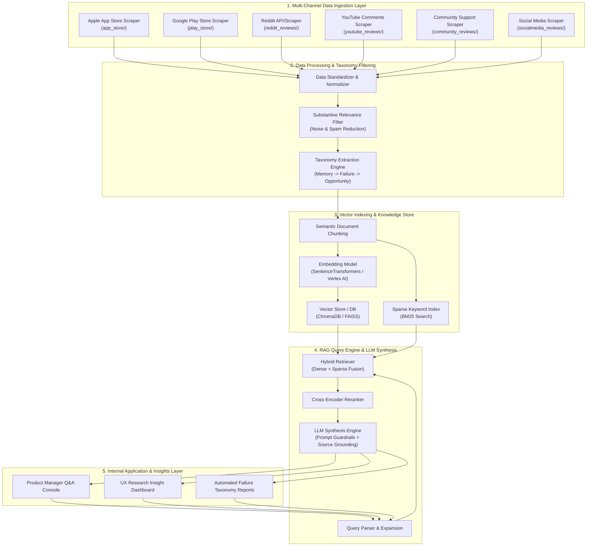
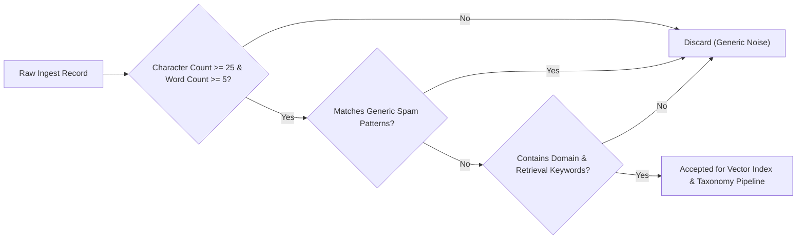
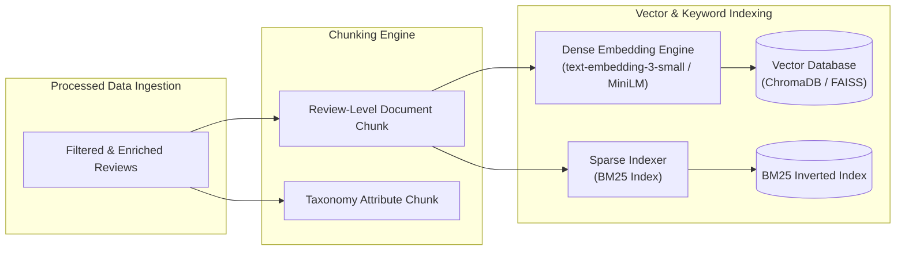
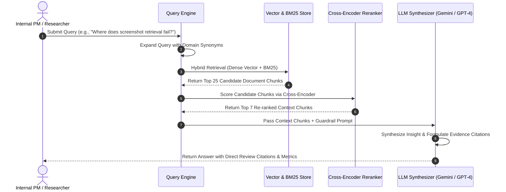

# Technical Architecture: Google Photos AI Retrieval Discovery Engine

## 1. System Architecture Overview

The **Google Photos AI Retrieval Discovery Engine** is an end-to-end data pipeline and Retrieval-Augmented Generation (RAG) system. It ingests, cleans, enriches, indexes, and analyzes multi-channel user feedback to provide evidence-based insights into visual memory retrieval breakdowns.

### High-Level Architectural Block Diagram



---

## 2. Multi-Channel Data Ingestion Layer (ETL)

The ingestion layer extracts customer conversations across 6 public platforms using specialized scraping scripts.

### 2.1 Ingestion Components & Sources
| Source Folder | Source Platform | Ingestion Method | Output Format | Target Volume |
| :--- | :--- | :--- | :--- | :--- |
| `app_store/` | Apple App Store | iTunes RSS API + Multi-Region Aggregator | JSON & CSV | 500+ Filtered Reviews |
| `play_store/` | Google Play Store | Google Play Scraper API | JSON & CSV | 500+ Filtered Reviews |
| `reddit_reviews/` | Reddit (`r/googlephotos`, `r/techsupport`) | PRAW / Public Reddit API | JSON & CSV | 200+ Discussions |
| `community_reviews/` | Google Photos Help Community | Support Forum Web Crawler | JSON & CSV | 200+ Threads |
| `youtube_reviews/` | YouTube Comments | YouTube Data API v3 | JSON & CSV | 200+ Comments |
| `socialmedia_reviews/` | Social Media Platforms | Keyword Search Crawlers | JSON & CSV | 200+ Posts |

### 2.2 Standardized Unified Data Schema
All raw scraped data is normalized into a uniform JSON schema across all 6 ingest modules:

```json
{
  "review_id": "STRING (Unique identifier)",
  "source": "STRING (e.g., Apple App Store, Google Play, Reddit)",
  "author": "STRING (User handle or Anonymous)",
  "rating": "INTEGER (1-5 scale, null for forum posts)",
  "title": "STRING (Review title or thread subject)",
  "review": "STRING (Full text body)",
  "app_version": "STRING (App version if available)",
  "date": "STRING (ISO 8601 Timestamp)",
  "url": "STRING (Source permalink)",
  "metadata": {
    "country": "STRING",
    "upvotes": "INTEGER",
    "reply_count": "INTEGER"
  }
}
```

---

## 3. Data Cleaning & Taxonomy Processing Engine

Raw reviews contain significant noise (e.g., single-word ratings, unrelated complaints about account access or billing). The Data Processing Engine filters noise and enriches data with a 6-tier taxonomy.

### 3.1 Substantive Relevance Filtering Pipeline



### 3.2 Taxonomy Classification Pipeline
Each accepted review is tagged along the 6-stage analytical framework:

```
[ User Memory ] -> [ Retrieval Intent ] -> [ Search Behavior ] -> [ Retrieval Failure ] -> [ Underlying Problem ] -> [ Opportunity Area ]
```

| Taxonomy Dimension | Description | Example Values |
| :--- | :--- | :--- |
| **User Memory** | What the user remembers about the visual item | Color, general timeframe, event context, person's face, location |
| **Retrieval Intent** | What the user is trying to find or accomplish | Finding a prescription screenshot, showing old vacation photos, retrieving a receipt |
| **Search Behavior** | Strategy used to locate the item | Natural language search, date scrolling, album creation, filtering by face |
| **Retrieval Failure** | Point of failure in the user journey | Zero search results, date sorting error, unindexed text in screenshot |
| **Underlying Problem** | Core technical or design flaw | OCR indexing failure, missing metadata on downloaded media, UI tab redesign clutter |
| **Opportunity Area** | Actionable product improvement | Visual similarity search, semantic context search, screenshot OCR indexing |

---

## 4. Embedding, Indexing & Vector Database Layer

To power semantic Q&A and hybrid retrieval, enriched reviews are converted into dense vector embeddings and stored in a vector database alongside a sparse keyword index.



### 4.1 Indexing Specifications
* **Chunking Strategy**: Document-level chunking preserving full context + review metadata headers (Author, Source, Date, Rating).
* **Dense Embedding**: `all-MiniLM-L6-v2` or `text-embedding-3-small` (384/1536 dimensions).
* **Vector Store**: ChromaDB / FAISS for local low-latency vector similarity lookup.
* **Hybrid Search Strategy**: Reciprocal Rank Fusion (RRF) combining dense vector similarity with sparse BM25 keyword matching.

---

## 5. RAG Query Engine & LLM Synthesis Layer

The RAG engine transforms natural language queries from internal stakeholders into grounded, cited insights.



### 5.1 System Prompt Guardrails
To enforce zero-hallucination and evidence grounding, the LLM receives strict instructions:
1. **Strict Context Alignment**: Answer only using the provided retrieved context.
2. **Citation Requirement**: Every assertion must reference the exact `[review_id]` and `[source]`.
3. **Structured Taxonomy Output**: Frame insights in terms of *User Memory -> Search Behavior -> Failure -> Opportunity*.
4. **Quantified Summary**: Include review counts and percentage distributions when summarizing failure modes.

---

## 6. Codebase Mapping & Component Directory

The architecture maps directly to the repository structure:

```
Google photots discovery engine/
├── app_store/                           # Apple App Store Ingestion Module
│   ├── scrape_reviews.py                # Scraper, relevance filter, & region aggregator
│   ├── google_photos_app_store_reviews.json
│   └── google_photos_app_store_reviews.csv
├── play_store/                          # Google Play Store Ingestion Module
│   ├── scrape_reviews.py                # Scraper & Android feedback parser
│   ├── google_photos_reviews.json
│   ├── google_photos_reviews.csv
│   └── docs/                            # Core Documentation
│       ├── problem_statement.txt
│       ├── context.md                   # Business Context & Requirements
│       └── Architecture.md              # Technical Architecture & Pipeline Design
├── reddit_reviews/                      # Reddit Discussion Ingestion Module
│   ├── scrape_reviews.py
│   ├── google_photos_reddit_reviews.json
│   └── google_photos_reddit_reviews.csv
├── community_reviews/                   # Google Help Forum Ingestion Module
│   ├── scrape_reviews.py
│   ├── google_photos_community_reviews.json
│   └── google_photos_community_reviews.csv
├── youtube_reviews/                     # YouTube Comments Ingestion Module
│   ├── scrape_reviews.py
│   ├── google_photos_youtube_reviews.json
│   └── google_photos_youtube_reviews.csv
├── socialmedia_reviews/                 # Social Media Ingestion Module
│   ├── scrape_socialmedia_reviews.py
│   ├── google_photos_socialmedia_reviews.json
│   └── google_photos_socialmedia_reviews.csv
├── context.md                           # Root Context Document
└── Architecture.md                      # Root Technical Architecture Document
```

---

## 7. Security, Reliability & Operational Characteristics

### 7.1 Data Privacy & Ethics
* **Public Data Usage**: Only publicly posted user reviews and community discussions are processed.
* **PII Redaction**: User handles and text bodies are sanitized to strip email addresses, phone numbers, and personal identifiers.

### 7.2 Fault Tolerance & Scraper Reliability
* **Rate-Limit Handling**: Backoff strategies and user-agent rotation across RSS and web endpoints.
* **Multi-Region Redundancy**: Ingestion spans 20+ App Store country endpoints to ensure steady candidate retrieval even if a single region endpoint drops.

### 7.3 Scalability
* **Modular Ingestion**: Independent scraper modules allow adding new platforms (e.g., Discord, Twitter) without refactoring existing ingestion logic.
* **Vector Index Incrementality**: Vector store updates incrementally using unique `review_id` hash deduplication.
