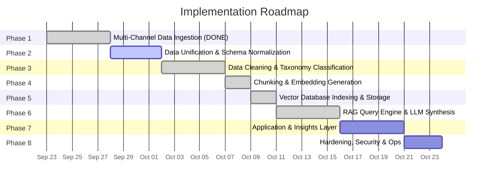
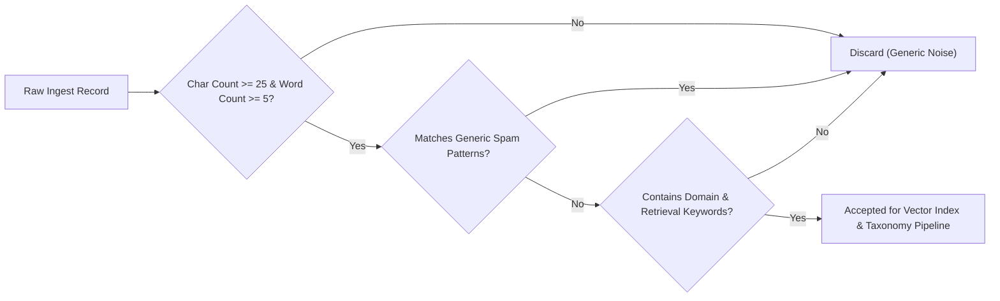
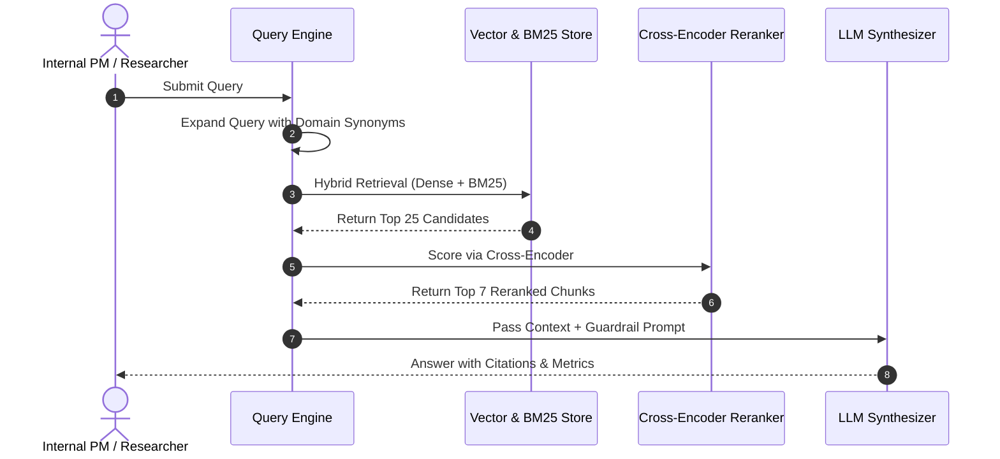

# Implementation Plan: Google Photos AI Retrieval Discovery Engine

> **Reference**: [Architecture.md](file:///home/testing/Development/Nextleap%20projects/Google%20photots%20discovery%20engine/play_store/docs/Architecture.md) · [Problem Statement](file:///home/testing/Development/Nextleap%20projects/Google%20photots%20discovery%20engine/play_store/docs/problem_statement.txt) · [Context](file:///home/testing/Development/Nextleap%20projects/Google%20photots%20discovery%20engine/context.md)

---

## Executive Summary

This plan translates the 5-layer architecture into **7 sequential implementation phases**, from raw data ingestion through to a production-grade internal insights application. Each phase maps directly to one or more architectural layers, with explicit tasks, deliverables, tech choices, and acceptance criteria.



---

## Current State Assessment

| Component | Status | Notes |
|:---|:---|:---|
| Apple App Store Scraper (`app_store/`) | ✅ Complete | JSON + CSV outputs present |
| Google Play Store Scraper (`play_store/`) | ✅ Complete | JSON + CSV outputs present |
| Reddit Scraper (`reddit_reviews/`) | ✅ Complete | JSON + CSV outputs present |
| Community Reviews Scraper (`community_reviews/`) | ✅ Complete | JSON + CSV outputs present |
| YouTube Comments Scraper (`youtube_reviews/`) | ✅ Complete | JSON + CSV outputs present |
| Social Media Scraper (`socialmedia_reviews/`) | ✅ Complete | JSON + CSV outputs present |
| Data Standardization & Normalization | ✅ Complete | `unified_corpus.json` |
| Relevance Filtering & Taxonomy Engine | ✅ Complete | `enriched_corpus.json` |
| Chunking & Embedding Generation | ✅ Complete | `chunked_corpus.json`, `embedded_corpus.json`, `embeddings.npy` |
| Vector DB Indexing & Storage | ✅ Complete | `chroma_db/`, `bm25_index.pkl`, `test_queries.md` |
| RAG Query Engine | ✅ Complete | `rag_engine/`, `evaluation_report.md` |
| Application & Insights Layer | ✅ Complete | `app/` |

---

## Phase 1 — Multi-Channel Data Ingestion Layer ✅ COMPLETE

> **Architecture Reference**: Layer 1 — Multi-Channel Data Ingestion Layer (Section 2)

### Objective
Extract user feedback from 6 public channels into raw JSON & CSV files.

### Status: DONE

All 6 ingestion scrapers have been built and executed. Raw data is available:

| Module | Script | Output Files |
|:---|:---|:---|
| `app_store/` | `scrape_reviews.py` | `google_photos_app_store_reviews.json`, `.csv` |
| `play_store/` | `scrape_reviews.py` | `google_photos_reviews.json`, `.csv` |
| `reddit_reviews/` | `scrape_reviews.py` | `google_photos_reddit_reviews.json`, `.csv` |
| `community_reviews/` | `scrape_reviews.py` | `google_photos_community_reviews.json`, `.csv` |
| `youtube_reviews/` | `scrape_youtube_reviews.py` | `google_photos_youtube_reviews.json`, `.csv` |
| `socialmedia_reviews/` | `scrape_socialmedia_reviews.py` | `google_photos_socialmedia_reviews.json`, `.csv` |

### Deliverables
- [x] 6 working scraper scripts
- [x] Raw JSON and CSV output files for all 6 sources

---

## Phase 2 — Data Unification & Schema Normalization ✅ COMPLETE

> **Architecture Reference**: Section 2.2 — Standardized Unified Data Schema

### Objective
Normalize all 6 raw scraped datasets into a **single unified JSON schema** and merge them into a consolidated corpus file.

### Dependencies
- Phase 1 (✅ Complete)

### Tasks

| # | Task | Description | Output |
|:--|:---|:---|:---|
| 2.1 | **Schema Audit** | Inspect each source's raw JSON to identify field name differences, missing fields, and data type inconsistencies across all 6 sources. | Schema audit report (field mapping matrix) |
| 2.2 | **Build Unified Normalizer** | Create `data_processing/normalize.py` that reads each source's raw JSON, maps fields to the unified schema, and handles missing/null values. | `data_processing/normalize.py` |
| 2.3 | **Implement Unified Schema** | Enforce the standardized schema for every record. | Validated schema per Architecture §2.2 |
| 2.4 | **Generate Unique `review_id`** | Create deterministic unique IDs using a hash of `(source + author + date + review_text[:100])` for deduplication. | Unique `review_id` per record |
| 2.5 | **Merge Into Unified Corpus** | Concatenate all normalized records into a single `data_processing/unified_corpus.json` and `unified_corpus.csv`. | `unified_corpus.json`, `unified_corpus.csv` |
| 2.6 | **Deduplication Pass** | Remove exact and near-duplicate reviews across sources using `review_id` hash matching. | Deduplicated corpus |

### Unified Schema (per Architecture §2.2)

```json
{
  "review_id": "STRING (Unique identifier)",
  "source": "STRING (e.g., Apple App Store, Google Play, Reddit)",
  "author": "STRING (User handle or Anonymous)",
  "rating": "INTEGER (1-5 scale, null for forum posts)",
  "title": "STRING (Review title or thread subject)",
  "review": "STRING (Full text body)",
  "app_version": "STRING (App version if available)",
  "date": "STRING (ISO 8601 Timestamp)",
  "url": "STRING (Source permalink)",
  "metadata": {
    "country": "STRING",
    "upvotes": "INTEGER",
    "reply_count": "INTEGER"
  }
}
```

### Tech Stack
- **Language**: Python 3.10+
- **Libraries**: `pandas`, `hashlib`, `json`, `dateutil`

### Acceptance Criteria
- [ ] All 6 source datasets normalized to the unified schema
- [ ] Zero schema validation errors on the merged corpus
- [ ] Unique `review_id` for every record; no duplicates
- [ ] `unified_corpus.json` and `unified_corpus.csv` generated with all records
- [ ] Date fields in ISO 8601 format across all records

### Estimated Directory Structure
```
data_processing/
├── normalize.py              # Schema normalizer for all 6 sources
├── unified_corpus.json       # Merged, normalized corpus
├── unified_corpus.csv        # CSV version
└── schema_audit_report.md    # Field mapping audit
```

---

## Phase 3 — Data Cleaning & Taxonomy Classification ✅ COMPLETE

> **Architecture Reference**: Layer 2 — Data Processing & Taxonomy Filtering (Section 3)

### Objective
Filter noise/spam from the unified corpus using the 3-stage relevance filter, then classify each accepted review along the 6-tier taxonomy framework.

### Dependencies
- Phase 2 (Unified Corpus)

### Tasks

| # | Task | Description | Output |
|:--|:---|:---|:---|
| 3.1 | **Build Relevance Filter** | Implement the 3-stage filtering pipeline per Architecture §3.1: (1) Length filter (≥25 chars, ≥5 words), (2) Generic spam pattern matching, (3) Domain & retrieval keyword matching. | `data_processing/relevance_filter.py` |
| 3.2 | **Define Domain Keyword Dictionary** | Create a curated list of domain-relevant keywords (search, find, photo, memory, retrieve, album, scroll, filter, face, OCR, screenshot, etc.) and spam patterns (generic praise/complaints, account/billing noise). | `data_processing/keyword_dictionaries.py` |
| 3.3 | **Run Relevance Filtering** | Execute the filter on the full unified corpus. Log discard reasons and counts per stage. | `filtered_corpus.json`, filter stats report |
| 3.4 | **Build Taxonomy Classification Engine** | Create `data_processing/taxonomy_engine.py` using an LLM (Gemini / GPT-4) to classify each accepted review along the 6-tier taxonomy: User Memory → Retrieval Intent → Search Behavior → Retrieval Failure → Underlying Problem → Opportunity Area. | `data_processing/taxonomy_engine.py` |
| 3.5 | **Design Taxonomy Prompt Template** | Create a structured prompt that instructs the LLM to extract and classify each taxonomy dimension with example values from Architecture §3.2. | `data_processing/prompts/taxonomy_prompt.txt` |
| 3.6 | **Run Taxonomy Enrichment** | Execute taxonomy classification on all accepted reviews. Append taxonomy tags as additional fields to each record. | `enriched_corpus.json` |
| 3.7 | **Quality Validation** | Manually validate a random sample of 50 classified reviews against the taxonomy definitions. Measure classification accuracy. | QA validation report |

### Relevance Filter Pipeline (per Architecture §3.1)



### Taxonomy Dimensions (per Architecture §3.2)

| Dimension | Description | Example Values |
|:---|:---|:---|
| **User Memory** | What the user remembers about the visual item | Color, general timeframe, event context, person's face, location |
| **Retrieval Intent** | What the user is trying to find or accomplish | Finding a prescription screenshot, showing old vacation photos |
| **Search Behavior** | Strategy used to locate the item | Natural language search, date scrolling, album creation, filtering by face |
| **Retrieval Failure** | Point of failure in the user journey | Zero search results, date sorting error, unindexed text in screenshot |
| **Underlying Problem** | Core technical or design flaw | OCR indexing failure, missing metadata on downloaded media |
| **Opportunity Area** | Actionable product improvement | Visual similarity search, semantic context search, screenshot OCR indexing |

### Tech Stack
- **Language**: Python 3.10+
- **LLM API**: Google Gemini API or OpenAI GPT-4 (for taxonomy classification)
- **Libraries**: `re`, `json`, `google-generativeai` / `openai`

### Acceptance Criteria
- [ ] Relevance filter discards generic noise (< 25 chars, < 5 words), spam, and off-domain reviews
- [ ] Filter stats report showing count of records at each stage (raw → accepted → discarded + reason)
- [ ] Every accepted review has all 6 taxonomy dimensions populated (non-null)
- [ ] `enriched_corpus.json` contains full schema fields + taxonomy fields
- [ ] Manual QA sample shows ≥ 80% taxonomy classification accuracy

### Estimated Directory Structure
```
data_processing/
├── normalize.py                 # (from Phase 2)
├── relevance_filter.py          # 3-stage filtering pipeline
├── keyword_dictionaries.py      # Domain keywords + spam patterns
├── taxonomy_engine.py           # LLM-based taxonomy classifier
├── prompts/
│   └── taxonomy_prompt.txt      # Taxonomy classification prompt template
├── filtered_corpus.json         # Post-filter corpus
├── enriched_corpus.json         # Taxonomy-enriched corpus
├── filter_stats_report.md       # Filtering statistics
└── qa_validation_report.md      # Taxonomy QA results
```

---

## Phase 4 — Chunking & Embedding Generation ✅ COMPLETE

> **Architecture Reference**: Layer 3 — Vector Indexing & Knowledge Store (Section 4)

### Objective
Convert the enriched, taxonomy-tagged corpus into dense vector embeddings.

### Dependencies
- Phase 3 (Enriched Corpus)

### Tasks

| # | Task | Description | Output |
|:--|:---|:---|:---|
| 4.1 | **Design Chunking Strategy** | Implement rich document chunking. Prepend populated taxonomy tags (excluding "Not specified") and core metadata to the review text. Since average length is ~65 words, keep most as single documents. Use sliding window (250 words, 50 overlap) ONLY for exceptionally long reviews. | `indexing/chunker.py` |
| 4.2 | **Build Dense Embedding Pipeline** | Create embedding pipeline using `all-MiniLM-L6-v2` (384-dim) or `text-embedding-3-small` (1536-dim) via SentenceTransformers or Vertex AI. | `indexing/embedder.py` |

### Results

| Metric | Value |
|:---|:---|
| Records processed | 1,492 |
| Total chunks | 1,570 |
| Single-chunk docs | 1,446 |
| Multi-chunk docs | 46 |
| Avg words/chunk | 81.7 |
| Embedding model | `all-MiniLM-L6-v2` (384-dim) |
| L2 normalized | Yes |
| Processing time | 32.4s |

### Acceptance Criteria
- [x] Document chunker correctly formats enriched reviews
- [x] Embedding pipeline successfully converts chunks into dense vectors

### Estimated Directory Structure
```
indexing/
├── __init__.py              # Package init
├── chunker.py               # Rich document chunking (Task 4.1)
├── embedder.py              # Dense embedding pipeline (Task 4.2)
├── run_phase4.py            # Phase 4 orchestrator
├── chunked_corpus.json      # 1,570 chunked documents
├── embedded_corpus.json     # Chunks + 384-dim embeddings (17.9 MB)
└── embeddings.npy           # Standalone numpy array (1570, 384)
```

---

## Phase 5 — Vector Database Indexing & Storage ✅ COMPLETE

> **Architecture Reference**: Layer 3 — Vector Indexing & Knowledge Store (Section 4)

### Objective
Store embeddings in a vector database and create a sparse BM25 keyword index for low-latency hybrid retrieval.

### Dependencies
- Phase 4 (Embeddings generated)

### Tasks

| # | Task | Description | Output |
|:--|:---|:---|:---|
| 5.1 | **Set Up ChromaDB / FAISS Vector Store** | Initialize the vector database, define collection schema, and configure distance metric (cosine similarity). | `indexing/vector_store.py` |
| 5.2 | **Build BM25 Sparse Index** | Create a BM25 inverted index over the chunked documents for keyword-based retrieval. | `indexing/bm25_index.py` |
| 5.3 | **Ingest Enriched Corpus into Indices** | Run the full embedding + indexing pipeline over the enriched corpus. Embed all chunks, upsert into the vector store, and build the BM25 index. | Populated vector DB + BM25 index |
| 5.4 | **Implement `review_id`-Based Deduplication** | Ensure incremental indexing uses `review_id` hash to skip already-indexed documents on re-runs. | Idempotent indexing logic |
| 5.5 | **Validate Retrieval Quality** | Run a set of 10 test queries against both the dense and sparse indices. Verify that semantically relevant reviews are returned. | Retrieval quality test report |

### Indexing Specifications (per Architecture §4.1)

| Specification | Value |
|:---|:---|
| **Chunking Strategy** | Rich Document-level (Metadata + Populated Taxonomy + Text). Sliding window (250w/50w overlap) for >300w outliers. |
| **Dense Embedding Model** | `all-MiniLM-L6-v2` (384d) or `text-embedding-3-small` (1536d) |
| **Vector Store** | ChromaDB (local persistent) or FAISS |
| **Sparse Index** | BM25 inverted index |
| **Hybrid Strategy** | Reciprocal Rank Fusion (RRF) combining dense + sparse scores |

### Tech Stack
- **Language**: Python 3.10+
- **Libraries**: `sentence-transformers`, `chromadb` or `faiss-cpu`, `rank_bm25`

### Acceptance Criteria
- [x] All enriched reviews embedded and stored in the vector database
- [x] BM25 index built over the same document chunks
- [x] Vector similarity search returns semantically relevant results for test queries
- [x] BM25 keyword search returns relevant results for keyword-based queries
- [x] Incremental re-indexing skips existing `review_id` records without duplication
- [x] Retrieval quality test report passes for ≥ 8/10 test queries

### Estimated Directory Structure
```
indexing/
├── chunker.py               # Document chunking logic
├── embedder.py              # Dense embedding pipeline
├── vector_store.py          # ChromaDB / FAISS setup & operations
├── bm25_index.py            # BM25 sparse index builder
├── ingest.py                # Full ingestion orchestrator
├── chroma_db/               # Persistent ChromaDB storage (auto-generated)
└── test_queries.md          # Retrieval quality test cases & results
```

---

## Phase 6 — RAG Query Engine & LLM Synthesis ✅ COMPLETE

> **Architecture Reference**: Layer 4 — RAG Query Engine & LLM Synthesis Layer (Section 5)

### Objective
Build the core query processing pipeline: query expansion → hybrid retrieval → cross-encoder reranking → LLM-grounded synthesis with citations.

### Dependencies
- Phase 5 (Populated Vector Store + BM25 Index)

### Tasks

| # | Task | Description | Output |
|:--|:---|:---|:---|
| 6.1 | **Build Query Parser & Expansion Module** | Parse natural language queries, expand with domain synonyms (e.g., "photo" ↔ "image" ↔ "picture", "find" ↔ "search" ↔ "retrieve"), and generate expanded query variants. | `rag_engine/query_parser.py` |
| 6.2 | **Implement Hybrid Retriever** | Combine dense vector similarity search and BM25 keyword search using Reciprocal Rank Fusion (RRF). Retrieve top-25 candidate chunks. | `rag_engine/hybrid_retriever.py` |
| 6.3 | **Implement Cross-Encoder Reranker** | Use a cross-encoder model (e.g., `cross-encoder/ms-marco-MiniLM-L-6-v2`) to rescore the top-25 candidates. Return top-7 reranked context chunks. | `rag_engine/reranker.py` |
| 6.4 | **Design System Prompt & Guardrails** | Create the LLM system prompt enforcing the 4 guardrails from Architecture §5.1: (1) Strict context alignment, (2) Citation requirement with `[review_id]` + `[source]`, (3) Structured taxonomy output, (4) Quantified summary with counts/percentages. | `rag_engine/prompts/system_prompt.txt` |
| 6.5 | **Build LLM Synthesis Engine** | Integrate with Gemini or GPT-4 API. Pass the top-7 reranked chunks + system prompt to the LLM. Parse the structured response. | `rag_engine/llm_synthesizer.py` |
| 6.6 | **Build RAG Pipeline Orchestrator** | Create the end-to-end pipeline: `query → parse → expand → hybrid retrieve → rerank → synthesize → return`. | `rag_engine/pipeline.py` |
| 6.7 | **Evaluation & Tuning** | Test with 15–20 representative stakeholder queries (from Architecture §5 and Problem Statement). Evaluate answer quality, citation accuracy, and hallucination rate. Tune retrieval parameters (top-k, RRF weights, reranker threshold). | Evaluation report |

### RAG Pipeline Flow (per Architecture §5)



### System Prompt Guardrails (per Architecture §5.1)

1. **Strict Context Alignment** — Answer only from the provided retrieved context
2. **Citation Requirement** — Every assertion references `[review_id]` and `[source]`
3. **Structured Taxonomy Output** — Frame insights as *User Memory → Search Behavior → Failure → Opportunity*
4. **Quantified Summary** — Include review counts and percentage distributions

### Tech Stack
- **Language**: Python 3.10+
- **LLM API**: Google Gemini API or OpenAI GPT-4
- **Reranker**: `sentence-transformers` cross-encoder (`cross-encoder/ms-marco-MiniLM-L-6-v2`)
- **Libraries**: `google-generativeai` / `openai`, `sentence-transformers`

### Acceptance Criteria
- [x] Query expansion generates meaningful synonym-expanded variants
- [x] Hybrid retriever returns top-25 candidates with both semantic and keyword relevance
- [x] Cross-encoder reranker produces a top-7 ranked list that outperforms raw retrieval
- [x] LLM responses are strictly grounded in retrieved context (zero hallucination)
- [x] Every assertion in LLM output includes `[review_id]` and `[source]` citation
- [x] Evaluation report shows ≥ 85% answer relevance across test queries

### Estimated Directory Structure
```
rag_engine/
├── query_parser.py           # Query parsing & synonym expansion
├── hybrid_retriever.py       # Dense + BM25 fusion retrieval
├── reranker.py               # Cross-encoder reranking
├── llm_synthesizer.py        # LLM synthesis with guardrails
├── pipeline.py               # End-to-end RAG orchestrator
├── prompts/
│   └── system_prompt.txt     # LLM system prompt + guardrails
└── evaluation_report.md      # Query evaluation results
```

---

## Phase 7 — Internal Application & Insights Layer ✅ COMPLETE

> **Architecture Reference**: Layer 5 — Internal Application & Insights Layer (Section 5)

### Objective
Build the user-facing interfaces that enable Product Managers, UX Researchers, and leadership to interact with the RAG engine: a Q&A console, a UX insights dashboard, and automated taxonomy reports.

### Dependencies
- Phase 6 (Working RAG Pipeline)

### Tasks

| # | Task | Description | Output |
|:--|:---|:---|:---|
| 7.1 | **Build PM Q&A Console** | Create an interactive CLI where PMs can submit natural language queries and receive grounded, cited answers from the RAG engine. | `app/pm_console.py` |
| 7.2 | **Build Unified Web Frontend (Dashboard & Chatbot)** | Create a unified Streamlit visual dashboard combining: taxonomy distribution charts, failure mode heatmaps, source breakdown, and top opportunity areas with evidence, along with the interactive Q&A Chatbot interface. | `app/unified_frontend.py` |
| 7.3 | **Build Automated Failure Taxonomy Report Generator** | Create a script that auto-generates a comprehensive markdown/PDF report covering: top failure modes, frequency distributions, cross-source patterns, and opportunity rankings — all with review citations. | `app/taxonomy_report_generator.py` |
| 7.4 | **Build Unified Entry Point** | Create a main launcher that provides access to all 3 interfaces (Console, Dashboard, Report Generator). | `app/main.py` |
| 7.5 | **Example Query Library** | Pre-populate a library of 20+ recommended queries covering the Primary Research Questions from the Problem Statement and Context documents. | `app/example_queries.md` |

### Interface Specifications

#### PM Q&A Console
- Natural language input
- Structured answer output with taxonomy framing
- Review citations with `[review_id]`, `[source]`, and `[url]`
- Follow-up query support
- Export answers to markdown

#### UX Research Dashboard
- Taxonomy dimension distribution (bar/pie charts)
- Failure mode frequency heatmap
- Source-wise retrieval failure breakdown
- Opportunity area ranking with supporting evidence count
- Interactive filtering by source, taxonomy dimension, date range

#### Automated Taxonomy Reports
- Full 6-tier taxonomy analysis
- Cross-source pattern identification
- Quantified failure mode rankings
- Evidence-backed opportunity prioritization
- Export to Markdown and PDF

### Tech Stack
- **Language**: Python 3.10+
- **UI Framework**: Streamlit (primary) or Gradio
- **Visualization**: `plotly`, `altair`, or `matplotlib`
- **Report Generation**: `markdown`, `pdfkit` / `weasyprint`

### Acceptance Criteria
- [x] PM Q&A Console accepts natural language queries and returns grounded, cited answers
- [x] UX Dashboard displays interactive charts of taxonomy distributions and failure modes
- [x] Automated report generator produces a complete taxonomy report with citations
- [x] All interfaces connect to the live RAG pipeline (Phase 6)
- [x] Example query library covers all Primary Research Questions from the Problem Statement

### Estimated Directory Structure
```
app/
├── main.py                      # Unified launcher
├── pm_console.py                # PM Q&A CLI interface
├── unified_frontend.py          # Unified Web Frontend (Dashboard & Chatbot)
├── taxonomy_report_generator.py # Automated report generation
├── example_queries.md           # Pre-built query library
└── static/                      # Dashboard assets
```

---

## Phase 8 — Security, Hardening & Operational Readiness

> **Architecture Reference**: Section 7 — Security, Reliability & Operational Characteristics

### Objective
Harden the system with PII redaction, rate-limiting, fault tolerance, and operational tooling to ensure production-grade reliability.

### Dependencies
- Phase 7 (Working Application Layer)

### Tasks

| # | Task | Description | Output |
|:--|:---|:---|:---|
| 8.1 | **PII Redaction Pipeline** | Build a post-processing step that strips email addresses, phone numbers, and personal identifiers from all review text before indexing (per Architecture §7.1). | `data_processing/pii_redactor.py` |
| 8.2 | **Rate-Limit & Backoff Hardening** | Add exponential backoff, user-agent rotation, and retry logic to all 6 scrapers for resilient re-scraping (per Architecture §7.2). | Updated scraper scripts |
| 8.3 | **Incremental Index Updates** | Implement a pipeline for periodic re-scraping → normalization → filtering → incremental vector store upsert, using `review_id` deduplication (per Architecture §7.3). | `ops/incremental_update.py` |
| 8.4 | **Logging & Monitoring** | Add structured logging across all pipeline stages (ingestion, filtering, embedding, retrieval, synthesis). Include query latency tracking and error reporting. | `ops/logging_config.py` |
| 8.5 | **Configuration Management** | Centralize all configuration (API keys, model names, thresholds, file paths) into a single config file with environment variable overrides. | `config.py` / `.env.example` |
| 8.6 | **End-to-End Integration Test** | Run the complete pipeline from raw scraping through to a Q&A answer. Validate that the full data flow works without manual intervention. | Integration test script + report |
| 8.7 | **Documentation & README** | Write comprehensive project README with setup instructions, architecture overview, usage guide, and contribution guidelines. | `README.md` |

### Tech Stack
- **PII Detection**: `presidio-analyzer` / regex-based patterns
- **Logging**: Python `logging` module with structured JSON output
- **Config**: `python-dotenv`, `pydantic` settings

### Acceptance Criteria
- [ ] PII redaction removes emails, phone numbers, and personal identifiers with ≥ 95% recall
- [ ] All scrapers handle rate limiting gracefully with automatic retries
- [ ] Incremental pipeline adds new reviews without re-indexing the entire corpus
- [ ] Structured logs capture all pipeline stages with timestamps and error details
- [ ] All API keys and sensitive config externalized to environment variables
- [ ] End-to-end integration test passes from scraping to Q&A output
- [ ] Project README provides complete setup and usage instructions

### Estimated Directory Structure
```
ops/
├── incremental_update.py     # Periodic re-scrape + index update
├── logging_config.py         # Structured logging setup
├── integration_test.py       # End-to-end pipeline test
config.py                     # Centralized configuration
.env.example                  # Environment variable template
README.md                     # Project documentation
```

---

## Complete Project Directory Structure (Post-Implementation)

```
Google photots discovery engine/
├── app_store/                              # ✅ Phase 1 (DONE)
│   ├── scrape_reviews.py
│   ├── google_photos_app_store_reviews.json
│   └── google_photos_app_store_reviews.csv
├── play_store/                             # ✅ Phase 1 (DONE)
│   ├── scrape_reviews.py
│   ├── google_photos_reviews.json
│   ├── google_photos_reviews.csv
│   └── docs/
│       ├── problem_statement.txt
│       ├── context.md
│       ├── Architecture.md
│       └── implementation_plan.md          # 📌 This document
├── reddit_reviews/                         # ✅ Phase 1 (DONE)
│   ├── scrape_reviews.py
│   ├── google_photos_reddit_reviews.json
│   └── google_photos_reddit_reviews.csv
├── community_reviews/                      # ✅ Phase 1 (DONE)
│   ├── scrape_reviews.py
│   ├── google_photos_community_reviews.json
│   └── google_photos_community_reviews.csv
├── youtube_reviews/                        # ✅ Phase 1 (DONE)
│   ├── scrape_youtube_reviews.py
│   ├── google_photos_youtube_reviews.json
│   └── google_photos_youtube_reviews.csv
├── socialmedia_reviews/                    # ✅ Phase 1 (DONE)
│   ├── scrape_socialmedia_reviews.py
│   ├── google_photos_socialmedia_reviews.json
│   └── google_photos_socialmedia_reviews.csv
├── data_processing/                        # 🔲 Phase 2 + 3
│   ├── normalize.py
│   ├── relevance_filter.py
│   ├── keyword_dictionaries.py
│   ├── taxonomy_engine.py
│   ├── pii_redactor.py
│   ├── prompts/
│   │   └── taxonomy_prompt.txt
│   ├── unified_corpus.json
│   ├── filtered_corpus.json
│   └── enriched_corpus.json
├── indexing/                               # 🔲 Phase 4 & 5
│   ├── chunker.py
│   ├── embedder.py
│   ├── vector_store.py
│   ├── bm25_index.py
│   ├── ingest.py
│   └── chroma_db/
├── rag_engine/                             # ✅ Phase 6 (DONE)
│   ├── query_parser.py
│   ├── hybrid_retriever.py
│   ├── reranker.py
│   ├── llm_synthesizer.py
│   ├── pipeline.py
│   └── prompts/
│       └── system_prompt.txt
├── app/                                    # ✅ Phase 7 (DONE)
│   ├── main.py
│   ├── pm_console.py
│   ├── unified_frontend.py
│   ├── taxonomy_report_generator.py
│   └── example_queries.md
├── ops/                                    # 🔲 Phase 8
│   ├── incremental_update.py
│   ├── logging_config.py
│   └── integration_test.py
├── config.py
├── .env.example
├── requirements.txt
├── context.md
├── Architecture.md
└── README.md
```

---

## Phase Dependency Graph

```mermaid
graph LR
    P1["Phase 1<br/>Data Ingestion<br/>✅ DONE"] --> P2["Phase 2<br/>Schema Normalization<br/>✅ DONE"]
    P2 --> P3["Phase 3<br/>Cleaning & Taxonomy<br/>✅ DONE"]
    P3 --> P4["Phase 4<br/>Chunking & Embedding<br/>✅ DONE"]
    P4 --> P5["Phase 5<br/>Vector Database Indexing<br/>✅ DONE"]
    P5 --> P6["Phase 6<br/>RAG Engine<br/>✅ DONE"]
    P6 --> P7["Phase 7<br/>Application Layer<br/>✅ DONE"]
    P7 --> P8["Phase 8<br/>Hardening & Ops"]

    style P1 fill:#2d6a4f,stroke:#1b4332,color:#fff
    style P2 fill:#2d6a4f,stroke:#1b4332,color:#fff
    style P3 fill:#2d6a4f,stroke:#1b4332,color:#fff
    style P4 fill:#2d6a4f,stroke:#1b4332,color:#fff
    style P5 fill:#2d6a4f,stroke:#1b4332,color:#fff
    style P6 fill:#2d6a4f,stroke:#1b4332,color:#fff
    style P7 fill:#2d6a4f,stroke:#1b4332,color:#fff
    style P8 fill:#264653,stroke:#1d3557,color:#fff
```



---

## Risk Register

| Risk | Impact | Mitigation |
|:---|:---|:---|
| LLM taxonomy classification inconsistency | Medium | Use few-shot prompting with 5+ examples per taxonomy dimension; add validation pass |
| API rate limits on LLM calls during taxonomy enrichment | High | Implement batch processing with exponential backoff; cache classification results |
| Scraper data quality degrades over time | Medium | Periodic re-scraping with incremental deduplication (Phase 8) |
| ChromaDB performance on large corpus | Low | Corpus size (~1500 reviews) is well within ChromaDB local limits |
| LLM hallucination in RAG responses | High | Strict guardrail prompt enforcing context-only answers + citation requirement |
| Cross-encoder reranker latency | Low | Reranking only 25 candidates is fast; use lightweight model variant |

---

> **Next Step**: Begin **Phase 8 — Security, Hardening & Operational Readiness** to harden the system with PII redaction and operational tooling.
